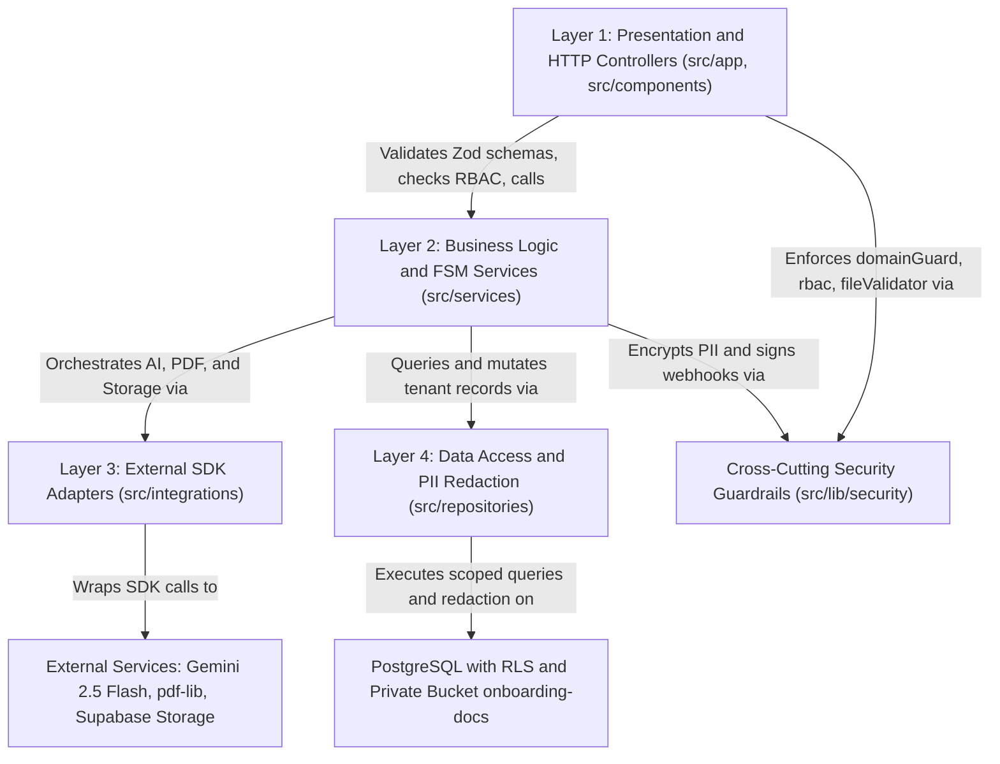
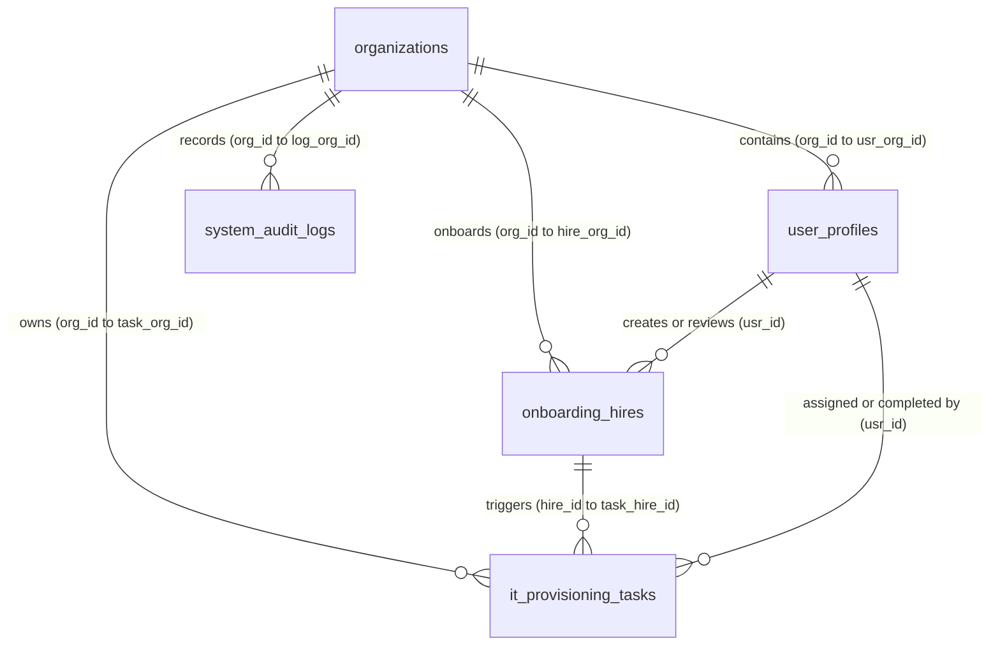
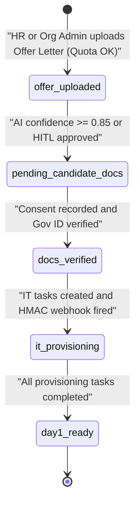

# StartSlate — System Architecture & Cybersecurity Specification

> **Brand Identity:** **StartSlate** — *"A clean slate for every new hire."*  
> **Domain:** Multi-Tenant B2B SaaS for Automated New-Hire Onboarding Paperwork & IT Provisioning  
> **Schema Reference:** [DATABASE_SCHEMA.sql](file:///c:/Users/Administrator/startslate/docs/DATABASE_SCHEMA.sql)  
> **Compliance Baseline:** Philippine Data Privacy Act of 2012 (Republic Act No. 10173) & National Privacy Commission (NPC) IRR

---

## 1. System Overview, Brand Identity & Engineering Constraints

### 1.1 Product Purpose
StartSlate automates post-offer onboarding between HR, candidates, Department Managers, and IT operations. It extracts structured data from Offer Letters and Government IDs via Google Gemini 2.5 Flash, enforces Human-in-the-Loop (HITL) review when confidence falls below `0.85`, collects candidate documents through a mobile-first passwordless portal, dispatches HMAC-SHA256 signed IT provisioning webhooks, and compiles flattened onboarding PDF packets.

### 1.2 Brand & Aesthetic Tokens
| Token / Role | Hex / Tailwind Token | Usage Guidelines |
| :--- | :--- | :--- |
| **Primary Surface / Ink** | `#0F172A` / `slate-900` | Deep Slate Navy navigation shell, primary headers, authority badges |
| **Primary Accent / Action** | `#10B981` / `emerald-500` | Crisp Emerald CTAs, verified states, `day1_ready` status indicators |
| **App Surface / Canvas** | `#F8FAFC` / `slate-50` | Alabaster page backgrounds, card containers, neutral surfaces |
| **HITL / Attention State** | `#F59E0B` / `amber-500` | Human-in-the-Loop verification alerts (`confidence_score < 0.85`) |
| **Security / Failure State** | `#F43F5E` / `rose-500` | Magic-byte rejection, quota exhaustion, RBAC denials, webhook failures |

### 1.3 Strict Tech Stack & Coding Standards
- **Framework:** Next.js App Router in **plain JavaScript (`.js` / `.jsx` / `.mjs`)** — strictly **NO TypeScript** (`.ts` / `.tsx` files are prohibited; path aliases use `jsconfig.json`, and `shadcn/ui` uses `"tsx": false` in `components.json`).
- **UI & Styling:** Tailwind CSS, `shadcn/ui`, and `lucide-react`.
- **Database, Auth & Storage:** Supabase (`@supabase/supabase-js`, `@supabase/ssr`) backed by PostgreSQL with Row-Level Security (RLS) and private storage bucket `onboarding-docs`.
- **AI & Document Processing:** Google Gemini 2.5 Flash (`@google/genai`, model `gemini-2.5-flash` with strict `responseSchema`), `pdf-lib`, and `zod`.
- **Mandatory JSDoc Standard:** Every `.js`, `.jsx`, and `.mjs` module and exported function must document `@description`, `@param`, `@returns`, and `@throws`.

---

## 2. Decoupled 4-Layer Software Architecture

StartSlate enforces strict unidirectional dependencies across four application layers plus the cross-cutting cybersecurity module in `src/lib/security/`.



### 2.1 Layer Responsibilities & Dependency Prohibitions

| Layer | Directory | Core Modules | Explicit Dependency Prohibitions |
| :--- | :--- | :--- | :--- |
| **Layer 1: Presentation & HTTP** | `src/app/`, `src/components/` | Pages, layouts, UI components, `/api/**` controllers | Must **never** import `@google/genai`, `pdf-lib`, or issue raw PostgreSQL queries. Must **never** encode FSM transitions or quota calculations inside HTTP handlers. |
| **Layer 2: Services & FSM** | `src/services/` | `onboarding.service.js`, `provisioning.service.js`, `packet.service.js` | Must **never** couple to Next.js `Request`/`Response` objects or expose unredacted PII to unauthorized roles. |
| **Layer 3: Integrations** | `src/integrations/` | `gemini.adapter.js`, `pdf.adapter.js`, `storage.adapter.js` | Must **never** enforce workflow state rules, RBAC permissions, or monthly quotas. Pure external SDK adapters only. |
| **Layer 4: Repositories** | `src/repositories/` | `hires.repo.js`, `tasks.repo.js`, `audit.repo.js` | Must **never** invoke Gemini, `pdf-lib`, or external HTTP webhooks. Must bind every operation to `org_id` and apply role-based redaction. |
| **Cross-Cutting Security** | `src/lib/security/` | `domainGuard.js`, `rbac.js`, `fileValidator.js`, `crypto.js` | Pure, reusable security primitives with zero dependencies on `src/app/` or `src/services/`. |

### 2.2 Application Route Map (`src/app/`)
- `/` — Landing page with no-signup ephemeral Offer Letter demo and hybrid pricing table.
- `/privacy` & `/terms` — Philippine Data Privacy Act (RA 10173) privacy notice, DPA terms, and retention disclosures.
- `/login` & `/signup` — Corporate domain registration gate enforced via `domainGuard.js`.
- `/dashboard` — Role-aware workspace (`org_admin`, `hr_admin`, `it_admin`, `department_manager`).
- `/settings` — Team role invites, department-to-IT-task provisioning rules, webhook URL/secret rotation, and retention policy settings.
- `/portal/[token]` — Mobile-first passwordless candidate portal (explicit RA 10173 consent + Government ID upload).
- `/api/**` — Thin HTTP controllers executing a strict 4-step pipeline.

### 2.3 Standardized API Controller Pipeline & Response Envelope
Every API route handler executes:
1. **Zod Validation:** Validate path params, JSON body, or `FormData` fields (plus `validateFileUpload` for uploaded binaries).
2. **Auth & RBAC / Portal Token Check:** Resolve `user_profiles` via Supabase SSR and enforce `authorizeAction(userProfile, permission)`, or verify `SHA-256(token)` + TTL for portal routes.
3. **Service Call:** Delegate to the single matching method in `src/services/`.
4. **Standardized JSON Envelope:** Return `{ success, data, error }` with `Cache-Control: no-store` on all PII/authenticated responses.

```json
{
  "success": true,
  "data": {},
  "error": null
}
```

---

### 2.4 Database Client Strategy
| Client | Module | Used For |
| :--- | :--- | :--- |
| **User-session client** (anon key + auth cookies) | `src/lib/supabase/server.js` | Resolving the signed-in `user_profiles` row and all actor-facing reads, so RLS and `onboarding_hires_redacted_v` apply. |
| **Service-role client** (server-only) | `src/lib/supabase/admin.js` | Writes performed **after** `authorizeAction()` passes, passwordless candidate-portal flows (no session), quota RPCs (`consume_org_hire_quota`, `release_org_hire_quota`), private storage, and audit writes. |

Service-role queries bypass RLS, so every repository method that uses them takes an explicit `orgId` and filters on `*_org_id`. Storage paths are checked against the `{org_id}/` prefix before any signed URL is issued.

---

## 3. Multi-Tenant Data Model & PostgreSQL Schema

Defined canonically in [DATABASE_SCHEMA.sql](file:///c:/Users/Administrator/startslate/docs/DATABASE_SCHEMA.sql), all five core tables enforce strict column prefixes (`org_`, `usr_`, `hire_`, `task_`, `log_`) and B-tree indexes.



### 3.1 Table Summary
- `public.organizations` (`org_` prefix): Tenant metadata, subscription tier (`free_trial`, `starter`, `growth`, `enterprise`), monthly hire quota counters (`org_monthly_hires_used`, `org_monthly_hires_limit`, `org_quota_reset_at`), encrypted webhook secret (`org_it_webhook_secret_enc`), department IT rules (`org_it_rules_json`), DPO email, and retention window.
- `public.user_profiles` (`usr_` prefix): Linked 1:1 with `auth.users(id)`, stores organization membership, role (`org_admin`, `hr_admin`, `it_admin`, `department_manager`), required `usr_department_name` for managers, and account status.
- `public.onboarding_hires` (`hire_` prefix): Stores FSM status, candidate metadata, encrypted Government ID number (`hire_gov_id_number_enc`), private storage keys (`hire_offer_letter_path`, `hire_gov_id_image_path`, `hire_packet_pdf_path`), AI confidence score, HITL flags, portal token SHA-256 hash, and RA 10173 consent timestamp.
- `public.it_provisioning_tasks` (`task_` prefix): Department-derived provisioning checklist items (`hardware`, `iam`, `saas`, `security`), completion attribution, and webhook delivery telemetry (`task_webhook_status`).
- `public.system_audit_logs` (`log_` prefix): Append-only compliance ledger recording actor role, action, entity target, salted IP hash, and PII-free JSON metadata. Protected by `REVOKE UPDATE, DELETE, TRUNCATE` and PostgreSQL `RULE`s (`prevent_system_audit_logs_update` and `prevent_system_audit_logs_delete` with `DO INSTEAD NOTHING`).

### 3.2 RLS Isolation & 3-Layer PII Redaction Defense-in-Depth
1. **PostgreSQL Row-Level Security (RLS):** `SECURITY DEFINER` helpers (`current_usr_org_id()`, `current_usr_role()`, `current_usr_department()`, `hire_in_current_usr_department()`) bind all queries to the caller's tenant (`*_org_id`). Because RLS is row-level only, SELECT on the `onboarding_hires` base table is limited to `org_admin` / `hr_admin`.
2. **Restricted View (`public.onboarding_hires_redacted_v`):** Definer-rights view with `security_barrier = true` and tenant + department scoping in its `WHERE` clause. It is the only hire read path for `it_admin` and `department_manager`, and emits `NULL` for `hire_base_salary_amount`, `hire_gov_id_image_path`, `hire_gov_id_number_enc`, `hire_extracted_pii_json`, `hire_offer_letter_path`, `hire_packet_pdf_path`, and `hire_personal_email`.
3. **Repository Projection & Runtime Redaction (`hires.repo.js` + `rbac.js`):** Queries `onboarding_hires_redacted_v` and runs `redactHireForRole(userProfile, record)` whenever `!canViewHirePII(userProfile)` (`it_admin` or `department_manager`).

**Anon-key hardening (direct Supabase client access):**
- `consume_org_hire_quota()` is executable by `service_role` only.
- Column-level grants stop tenants from editing `org_subscription_tier`, quota counters, or `org_it_webhook_secret_enc`.
- `hr_admin` cannot create, modify, or promote `org_admin` profiles.
- Audit inserts must match the caller (`log_actor_usr_id = auth.uid()`); portal/system events are written server-side.
- `system_audit_logs` uses `ON DELETE RESTRICT` for its org link and has no actor FK, since cascaded deletes/updates would conflict with the append-only rules.

---

## 4. Onboarding Finite State Machine (FSM) & Core Workflows



### 4.1 Core Business Rules (`src/services/`)
1. **Atomic Monthly Quota Enforcement (`onboarding.service.js`):** Calls `consume_org_hire_quota(p_org_id)` before creating a hire record, verifying `org_monthly_hires_used < org_monthly_hires_limit`. Exhausted quotas return HTTP `402` (`QUOTA_EXCEEDED`).
2. **Gemini 2.5 Flash Extraction & HITL Gate (`gemini.adapter.js` + `onboarding.service.js`):** Uses `gemini-2.5-flash` with `responseMimeType: "application/json"`, strict `responseSchema`, and Zod re-validation. If `confidence_score < 0.85`, `hire_needs_hitl_review` is set to `true` and state progression halts until an `org_admin` or `hr_admin` reviews and confirms the fields.
3. **Department IT Provisioning & Signed Webhooks (`provisioning.service.js`):** Maps `hire_department_name` to `org_it_rules_json` task templates, creates idempotent `it_provisioning_tasks`, and posts a strictly PII-free payload to `org_it_webhook_url` signed with HMAC-SHA256 (`X-StartSlate-Signature: t=<unix_ts>,v1=<hex_hmac>`). Automatically transitions `onboarding_hires.hire_status` to `day1_ready` once zero incomplete tasks remain.
4. **Flattened PDF Packet & Trial Watermark (`packet.service.js` + `pdf.adapter.js` + `storage.adapter.js`):** Compiles and flattens the onboarding packet via `pdf-lib`. When `org_subscription_tier === 'free_trial'`, stamps a diagonal `"SAMPLE - FREE TRIAL"` watermark on every page. Serves files solely via 60-second expiring Signed URLs from the private `onboarding-docs` bucket.

---

## 5. RBAC Permission Matrix & Field-Level Visibility

Enforced centrally via `authorizeAction(userProfile, permission)` and `redactHireForRole(userProfile, hireRecord)` in [rbac.js](file:///c:/Users/Administrator/startslate/src/lib/security/rbac.js).

### 5.1 Role Permission Matrix (`org_admin`, `hr_admin`, `it_admin`, `department_manager`)

| Action / Permission | `org_admin` | `hr_admin` | `it_admin` | `department_manager` |
| :--- | :---: | :---: | :---: | :---: |
| Manage Org Profile, Billing & Retention (`org:manage`) | Allow | Deny | Deny | Deny |
| Invite & Manage User Profiles / Roles (`users:manage`) | Allow | Allow | Deny | Deny |
| Configure Department IT Rules (`it_rules:manage`) | Allow | Allow | Allow | Deny |
| Configure & Rotate IT Webhook URL/Secret (`webhook:manage`) | Allow | Deny | Allow | Deny |
| Upload Offer Letter & Create Hire (`hire:create`) | Allow | Allow | Deny | Deny |
| Perform HITL Review & Approve Extraction (`hire:hitl_review`) | Allow | Allow | Deny | Deny |
| View Operational Hire Metadata (`hire:read_operational`) | Allow | Allow | Allow | Dept-Scoped Only |
| View Sensitive Hire PII & Docs (`hire:read_pii`) | Allow | Allow | **Redacted** | **Redacted** |
| Compile & Download Onboarding Packet (`packet:generate`) | Allow | Allow | Deny | Deny |
| Update IT Provisioning Task Status (`task:update`) | Allow | Deny | Allow | Deny |
| View IT Provisioning Tasks (`task:read`) | Allow | Allow | Allow | Dept-Scoped Only |
| Retry Failed IT Provisioning Webhook (`webhook:retry`) | Allow | Allow | Allow | Deny |
| View Append-Only Audit Logs (`audit:read`) | Allow | Allow | Allow | Deny |
| Execute RA 10173 PII Erasure Purge (`hire:purge_pii`) | Allow | Allow | Deny | Deny |

### 5.2 Field-Level Visibility on `onboarding_hires`

| Field Group | `org_admin` / `hr_admin` | `it_admin` | `department_manager` |
| :--- | :--- | :--- | :--- |
| `hire_id`, `hire_status`, `hire_full_name`, `hire_work_email`, `hire_job_title`, `hire_department_name`, `hire_start_date` | Visible | Visible | Visible (Own Dept) |
| `hire_personal_email` | Visible | **Redacted** | **Redacted** |
| `hire_base_salary_amount`, `hire_salary_currency` | Visible | **Redacted** | **Redacted** |
| `hire_offer_letter_path`, `hire_gov_id_image_path`, `hire_packet_pdf_path` | 60s Signed URL (Server HR Gate) | **Redacted** | **Redacted** |
| `hire_gov_id_type`, `hire_gov_id_number_enc`, `hire_extracted_pii_json` | Decrypted/Masked for HR Review | **Redacted** | **Redacted** |

---

## 6. Cybersecurity Foundation (`src/lib/security/` & HTTP Headers)

| Component | Implementation Details |
| :--- | :--- |
| [domainGuard.js](file:///c:/Users/Administrator/startslate/src/lib/security/domainGuard.js) | `extractCorporateDomain(email)` and `assertCorporateEmail(email)` normalize email addresses and block public webmail (`gmail.com`, `yahoo.com`, `hotmail.com`, `outlook.com`, plus disposable providers) during corporate signup. |
| [rbac.js](file:///c:/Users/Administrator/startslate/src/lib/security/rbac.js) | Defines `ROLES`, `PERMISSIONS`, `ROLE_PERMISSION_MATRIX`, `authorizeAction(userProfile, permission)`, `canViewHirePII(userProfile)`, `redactHireForRole(userProfile, hireRecord)`, and `assertDepartmentScope(userProfile, hireRecord)`. |
| [fileValidator.js](file:///c:/Users/Administrator/startslate/src/lib/security/fileValidator.js) | Inspects binary magic bytes—accepting ONLY valid PDF (`%PDF-`), JPEG (`FFD8FF`), and PNG (`89504E470D0A1A0A`) strictly under `5MB` (`< 5,242,880` bytes)—and sanitizes filenames. |
| [crypto.js](file:///c:/Users/Administrator/startslate/src/lib/security/crypto.js) | Implements `encryptPII(text, aad)` and `decryptPII(payload, aad)` using native `node:crypto` `aes-256-gcm` with a random 12-byte IV, 16-byte auth tag, and 64-char hex `process.env.PII_ENCRYPTION_KEY`. Also provides SHA-256 portal token hashing and timing-safe HMAC-SHA256 webhook verification. |
| [next.config.mjs](file:///c:/Users/Administrator/startslate/next.config.mjs) | Applies global `X-Frame-Options: DENY`, `X-Content-Type-Options: nosniff`, `Referrer-Policy: strict-origin-when-cross-origin`, `Strict-Transport-Security`, `Permissions-Policy`, and `Content-Security-Policy` headers. |

---

## 7. Philippine Data Privacy Act (RA 10173) Compliance Controls

- **PIC / PIP Allocation:** The subscribing enterprise acts as the **Personal Information Controller (PIC)**; StartSlate operates solely as the **Personal Information Processor (PIP)** processing data under documented instructions and designated DPO governance (`org_dpo_email`).
- **Sec. 11 (Proportionality & Data Minimization):** Non-HR personas (`it_admin`, `department_manager`) never receive salary figures, Government ID images, or extracted PII via database views (`onboarding_hires_redacted_v`) and `redactHireForRole`.
- **Sec. 12–13 (Explicit Consent for Sensitive Personal Information):** Candidate Government ID uploads in `/portal/[token]` are blocked until explicit RA 10173 consent is recorded in `hire_consent_accepted_at` and `hire_consent_version`.
- **Sec. 16 (Data Subject Rights — Rectification & Erasure):** HR HITL review corrects AI extraction inaccuracies; Right-to-Erasure purge removes Storage objects and encrypted PII fields while leaving redacted compliance audit entries intact.
- **Sec. 20 & NPC Circular 16-03 (Technical Safeguards & Auditability):** Enforces AES-256-GCM field encryption, private `onboarding-docs` storage with 60-second Signed URLs, binary magic-byte inspection, HTTP security headers, and strictly append-only `system_audit_logs` protected by PostgreSQL rules.
- **Ephemeral Demo Boundary:** The landing page `/` Offer Letter demo executes transiently in memory without writing files or PII to PostgreSQL or Supabase Storage.
